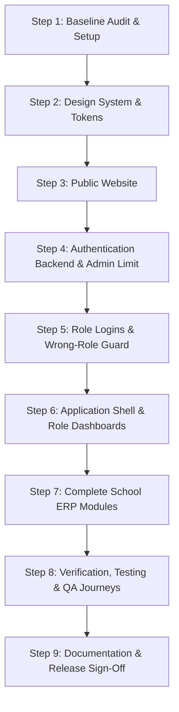

# SIMPLEIN SCHOOLS — Phase 1 Implementation Plan

**Product:** SimpleIn Schools  
**Company:** SIMPLEIN SOLUTIONS LLP  
**Document ID:** SIS-PLAN-P1-001  
**Status:** In Execution  

---

## 1. Scope & Execution Phases

---

## 2. Detailed Work Breakdown

### Workstream 1: Design System & Foundation
- Define `brand-tokens.ts` tailored for SimpleIn Schools (navy headings, soft-blue accents, pale background, emerald highlight).
- Configure `globals.css` with Tailwind CSS v4 custom theme and education tokens.
- Assemble UI primitives: Button, Input, Select, Badge, Card, Modal, Drawer, Table, Tabs, Switch, Breadcrumbs, Toast.

### Workstream 2: Public-Facing Marketing Website
- Header with responsive navigation, logo, desktop/mobile menu.
- Hero section with headline "One School. One Connected System", subcopy, primary CTA, secondary CTA, Demo Request dialog, live preview frame.
- Pain points & solutions grid (8 comprehensive problem-solution pairs).
- Master product feature catalogue (17 categories with Phase 1 vs Future Roadmap tags).
- User-role overview (Administrators, Teachers, Students, Parents).
- Interactive product dashboard preview.
- Commercial editions overview (Basic, Standard, Premium) with enquiry triggers.
- Comprehensive FAQ accordion (8 essential questions).
- Footer with legal links, contact information, branding, copyright.
- Dedicated standalone public pages: `/features`, `/solutions`, `/benefits`, `/pricing`, `/faq`, `/contact`, `/privacy`, `/terms`.

### Workstream 3: Real Authentication Backend & Security Engine
- Password hashing with `bcryptjs` (salt rounds >= 10).
- Session lifecycle: secure HttpOnly cookies, expiration, revocation.
- Administrator account restriction:
  - Atomic enforcement of MAX 2 administrator accounts.
  - Concurrency safety, role modification safety, reactivation guard.
  - Protection of the last remaining administrator from deletion or demotion.
  - Security audit logging (`audit_events`).
- Account provisioning service: Admin, Teacher, Student, Parent.
- Wrong-role login protection enforced server-side.
- Password recovery / reset token workflow.

### Workstream 4: Role-Specific Authentication Experiences
- `/login/teacher`: Authenticates teachers and administrators; authoritative role redirect.
- `/login/student`: Dedicated student login experience.
- `/login/parent`: Dedicated parent/guardian login experience with child link validation.
- Consistent UX: Show/hide password, field validation, loading states, invalid credentials handling, role switcher links.

### Workstream 5: Application Shell & Role Dashboards
- Application shell with collapsible responsive sidebar, header with role badge, breadcrumbs, search, quick action, notification dropdown, user menu.
- Role-specific dashboards:
  - Admin Dashboard (`/app/admin/dashboard`)
  - Teacher Dashboard (`/app/teacher/dashboard`)
  - Student Dashboard (`/app/student/dashboard`)
  - Parent Dashboard (`/app/parent/dashboard`) with linked child selector.

### Workstream 6: Complete School Management Modules
- 21 full module pages with search, filters, pagination, create/edit forms, validation, view detail modals, confirmation dialogs, loading/empty/error states.
- Clean isolation between authentication state and mock demonstration data via data repository adapters.

### Workstream 7: Testing, Release Verification & Documentation
- Unit tests, security tests, and end-to-end journey tests (Journeys A through F).
- Full suite of required Phase 1 documentation in `docs/phase-1/`.
